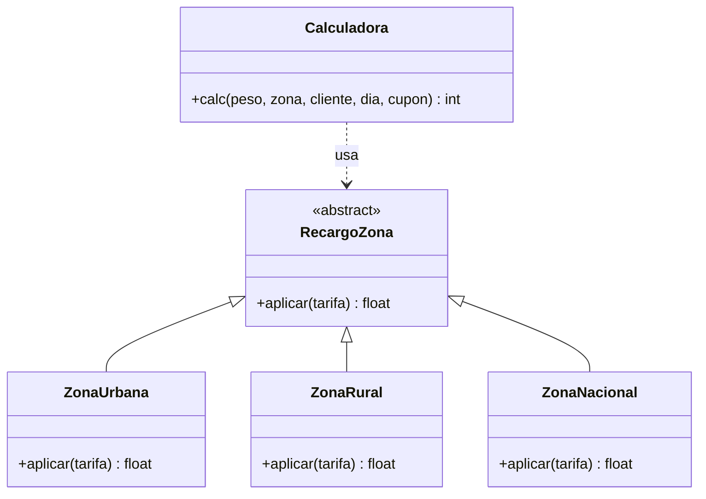

# Parte 6 · Mantenimiento y refactorización

Estudiante: Jhonar David De Arco Mejia · Código: 1029860263
Asignatura: Ingeniería de Software I (273365) · Grupo B1 · Parcial 3

## 1. Malos olores (code smells) del código heredado v1.0.0

Las líneas corresponden a `envios.py` v1.0.0 (`cat -n envios.py`).

| # | Mal olor (nombre técnico) | Línea(s) | Deuda técnica que genera |
|---|---|---|---|
| 1 | **Números mágicos** (*Magic Numbers*): 50, 6000, 9000, 800, 0.05, 0.10, 5000, 100 | 14, 17, 19, 21, 32, 37, 39, 42 | Una tarifa o un porcentaje vive disperso en el código y no dice qué significa. Cambiar una regla de negocio exige buscar cada número a mano y se pueden olvidar apariciones. |
| 2 | **Argumento bandera** (*Flag Argument*): `flag` | 13, 40–41 | La función hace dos cosas según un booleano (calcular y, a veces, imprimir). La interfaz es confusa y cada llamada obliga a entender qué modo se pide. |
| 3 | **Método largo** (*Long Method*): `calc` hace todo | 13–42 | Validación, tarifa, zona, fin de semana, descuentos, mínimo y redondeo en una sola función con complejidad ciclomática 15. Es difícil de leer, de probar por partes y de modificar sin romper algo. |
| 4 | **Nombres poco descriptivos** (*Mysterious Name*): `p, z, c, d, t, cup` | 13–42 | El lector debe adivinar qué guarda cada variable. Aumenta el tiempo de comprensión y el riesgo de errores al mantener. |
| 5 | **Efecto secundario dentro del cálculo** (*Side Effect*): `print` | 41 | Mezcla la lógica de negocio con la salida por consola. El cálculo no se puede reutilizar limpiamente ni probar sin capturar la salida. |
| 6 | **Código muerto / sentencia inútil** (*Dead Code*): `t = t` | 23 | No hace nada y confunde al lector, que se pregunta si falta algo. Es ruido que se acumula. |
| 7 | **Condicionales en cadena** (*Switch Statements*) por zona y por cliente | 22–27, 31–37 | Cada zona o cada tipo de descuento nuevo obliga a editar `calc`. Se viola el principio abierto/cerrado y crece la probabilidad de error. |
| 8 | **Comparación incorrecta con `None` y anidamiento innecesario** (`!= None`, `if` dentro de `if`) | 35–37 | `!= None` es una mala práctica en Python (debe usarse `is not None`) y el anidamiento complica algo que cabe en una condición. |
| 9 | **Configuración global mutable** (*Global Data*): `CONFIG` con comentarios obsoletos | 3–10 | Cualquier parte del programa puede modificar el diccionario. Los comentarios "pon tus valores" quedan desactualizados y los valores fijos del código (6000, 9000…) no están en CONFIG, lo que deja la configuración incompleta. |

## 2. Clasificación de los cambios

| Cambio | Tipo de mantenimiento | Justificación |
|---|---|---|
| DEF-01 a DEF-07: corregir los defectos | **Correctivo** | Corrigen comportamientos que incumplen la especificación. |
| Reemplazar números mágicos por constantes con nombre | **Perfectivo** | Mejora la legibilidad sin cambiar el comportamiento. |
| Extraer funciones y renombrar variables | **Perfectivo** | Mejora la estructura y la mantenibilidad. |
| Eliminar el argumento `flag` y el `print` | **Perfectivo** | Simplifica la interfaz y separa responsabilidades. Cambia la firma de `calc`, por eso exige versión MAJOR. |
| Aplicar el patrón Estrategia a las zonas | **Preventivo** | Prepara el código para zonas nuevas sin modificar `calc`. |
| Hora pico (Parte 8) | **Adaptativo** | Responde a un cambio de las reglas del negocio. |

## 3. Corrección de los defectos

Cada defecto se corrigió en su propia rama (`fix/DEF-0X`) y se integró con `merge --no-ff`.

| Defecto | Corrección aplicada | Rama | Fallas restantes en la suite |
|---|---|---|---|
| DEF-01 | El límite de peso usa `PMAX = 70` en lugar de 50 | `fix/DEF-01` | 16 |
| DEF-02 | Si la zona no es urbana, rural o nacional se lanza `ValueError` | `fix/DEF-02` | 15 |
| DEF-03 | Si el día no está entre 1 y 7 se lanza `ValueError` | `fix/DEF-03` | 13 |
| DEF-04 | El fin de semana pasa de `d > 6` a `d >= 6` (incluye el sábado) | `fix/DEF-04` | 10 |
| DEF-05 | Se calcula el descuento del cliente y el del cupón y se aplica solo el mayor (`max`) | `fix/DEF-05` | 5 |
| DEF-06 | Un cupón distinto de `ENVIO10` lanza `ValueError` | `fix/DEF-06` | 3 |
| DEF-07 | El redondeo pasa de truncar a redondear al múltiplo de $100 más cercano, con los $50 hacia arriba | `fix/DEF-07` | 0 |

Estado inicial: 18 fallas de 42 pruebas. Estado final: 0 fallas.

## 4. Refactorización (rama `refactor/estrategia`)

### 4.1 Constantes con nombre
Los números mágicos se reemplazaron por constantes: `PESO_MAXIMO`, `LIMITE_TRAMO_1`, `LIMITE_TRAMO_2`, `TARIFA_TRAMO_1`, `TARIFA_TRAMO_2`, `PRECIO_KG_EXTRA`, `RECARGO_RURAL`, `RECARGO_NACIONAL`, `RECARGO_FIN_DE_SEMANA`, `DESCUENTO_FRECUENTE`, `DESCUENTO_VIP`, `DESCUENTO_CUPON`, `COSTO_MINIMO` y `MULTIPLO_REDONDEO`.

### 4.2 Funciones extraídas
| Función | Responsabilidad |
|---|---|
| `validar_entradas` | Reglas R1, R2 y R7 (peso, zona, día y cupón) |
| `tarifa_base` | Regla R3 (tramos) |
| `recargo_fin_de_semana` | Regla R5 |
| `descuento_aplicable` | Regla R6: el mayor entre cliente y cupón |
| `redondear` | Regla R8: múltiplo de $100, los $50 suben |
| `calc` | Orquesta las funciones anteriores |

### 4.3 Eliminación del argumento `flag`
Se eliminó `flag` y el `print`. `calc` solo calcula y devuelve el valor. Como cambia la firma pública de la función, es un cambio incompatible (versión MAJOR). La prueba `test_flag_imprime_costo` se reemplazó por `test_calc_ya_no_acepta_flag`, que verifica que `calc` rechaza el argumento y no imprime.

### 4.4 Patrón Estrategia aplicado a las zonas
Cada zona es una estrategia que sabe aplicar su recargo (`RecargoZona.aplicar`). `calc` no conoce los detalles de cada zona: busca la estrategia en el diccionario `ZONAS`. Para agregar una zona nueva basta crear una clase y registrar una línea en `ZONAS`, sin modificar `calc`.

## 5. Pruebas de regresión

Se ejecutaron de nuevo las mismas pruebas de la Parte 5 (41 casos de la matriz y la prueba del argumento `flag`, que se reemplazó por la de la nueva firma).

| | Código heredado v1.0.0 | Código corregido y refactorizado |
|---|---|---|
| Pruebas ejecutadas | 42 | 42 |
| Pasan | 24 | 42 |
| Fallan | 18 | 0 |
| % que pasan | 57,1 % | 100 % |

Evidencia textual: `docs/pytest_regresion.txt` conserva la ejecución de v2.0.0 y `docs/pytest_final.txt` la ejecución actual de v3.0.0. Las capturas reales de terminal están en `docs/evidencia_pytest_heredado.png` (fallos del legado) y `docs/evidencia_pytest_regresion.png` (regresión final y cobertura).

## 6. Comparación antes y después

Antes (v1.0.0 - código heredado):
- Complejidad ciclomática de `calc`: **15 (C)** (medido con radon)
- Complejidad máxima de una función: **15**
- Complejidad promedio por bloque: **15**
- Líneas de `envios.py`: **42**
- Cobertura de sentencias: **100 % (29 de 29)**
- Cobertura de ramas: **100 % (26 de 26)**
- Pruebas que pasan: **24 de 42 (57,1 %)**
- Defectos conocidos: **7**

Después (v2.0.0 - refactorizado):
- Complejidad ciclomática de `calc`: **2**
- Complejidad máxima de una función: **8** (`validar_entradas`)
- Complejidad promedio por bloque: **2,29** (14 bloques analizados)
- Líneas de `envios.py`: **181** (líneas físicas totales incluyendo constantes, clases strategy, docstrings y firmas tipo Python; el objetivo no es acortar el archivo sino reducir la complejidad de cada función)
- Cobertura de sentencias: **99 %** (68 de 69 sentencias; la línea 27 no se ejecuta en la suite de v2.0.0)
- Cobertura de ramas: **100 %** (22 de 22 ramas ejecutadas)
- Pruebas que pasan: **42 de 42 (100 %)**
- Defectos conocidos: **0**
- Densidad de defectos: **0 defectos por cada 100 líneas**

Evidencia histórica de v2.0.0: `docs/pytest_regresion.txt`. La salida indica 68/69 sentencias (99 %) y 22/22 ramas (100 %); por eso el valor de sentencias no se reporta como 100 %. Las mediciones de complejidad de v1.0.0, v2.0.0 y v3.0.0 están en `docs/radon_complexity.txt`.

### Estado final v3.0.0

La validación de R2 ahora exige que `dia` sea un entero entre 1 y 7. También se alineó el texto de error de peso con R1 y se separaron las validaciones de día y hora. La suite final ejecuta **59 pruebas**: **59 pasan**, con **100 % de cobertura de sentencias (83/83) y ramas (28/28)**. La complejidad ciclomática de `calc` es 2, la máxima por función es 6 y el promedio de los 17 bloques analizados es 2,35.

Evidencia reproducible: `docs/pytest_final.txt`, generado con `python -m pytest -q --cov=envios --cov-branch --cov-report=term-missing`.

### Análisis
- Las líneas del archivo aumentan por las constantes nomencladas, las clases del patrón Estrategia y los docstrings. El objetivo del refactor no es acortar el archivo sino reducir la complejidad de cada función y facilitar su mantenimiento.
- La complejidad de `calc` bajó de 15 a 2 entre v1.0.0 y v2.0.0; la complejidad máxima por función bajó de 15 a 8. En v3.0.0 `calc` sigue en 2 y las validaciones separadas mantienen el máximo en 6.
- La cobertura del 100 % ya existía con el código heredado, y aun así había 7 defectos. La cobertura mide qué líneas se ejecutan, no si el resultado es correcto. Los defectos se detectaron con resultados esperados calculados a mano sobre la especificación.
- Se eliminó el argumento `flag` y el `print`, cambiando la firma pública de la función. Como esto es un cambio incompatible, la versión corresponde a **2.0.0** (MAJOR).

## 7. Conclusión
Se corrigieron los 7 defectos, se eliminaron los malos olores identificados y se aplicó el patrón Estrategia a las zonas. En v2.0.0 pasaron las 42 pruebas de esa etapa; en el estado final v3.0.0 pasan 59 pruebas con cobertura completa. Como se eliminó el argumento `flag` (cambio incompatible en la interfaz), la versión que corresponde a esa refactorización es **2.0.0**.